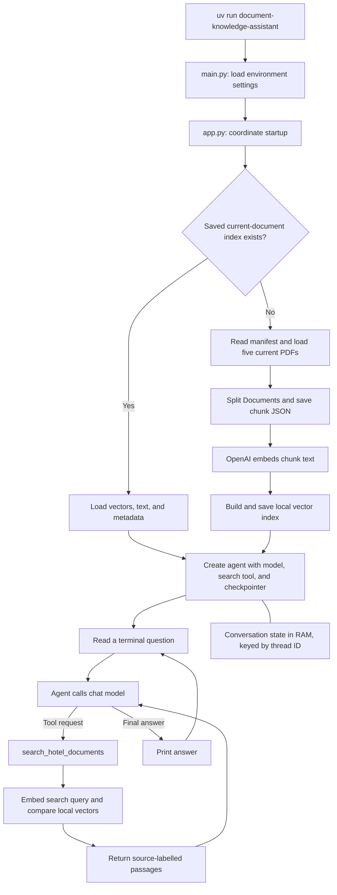

# Document Knowledge Assistant

A guided Python and LangChain project that answers questions about fictional Skyview Hotel documents. It combines a local document index, OpenAI models, an agent-operated search tool, and conversation memory.

This README explains the topics implemented so far and the Python ideas used to connect them. Reviewed against the saved source code and local index on October 16, 2026.

## Start here

Requirements: Python 3.13 or newer, uv, and an OpenAI API key.

From the project folder, install the locked dependencies:

```bash
uv sync --locked
```

Create a local `.env` file alongside `pyproject.toml`:

```dotenv
OPENAI_API_KEY=replace_with_your_key
```

Run the assistant:

```bash
uv run document-knowledge-assistant
```

Type a hotel question at the prompt. Type `exit` to finish. The first index build embeds the document chunks through OpenAI. Later runs load their saved vectors. Searching embeds each search query, and the agent uses the chat model to produce responses.

The hotel PDFs are synthetic training material. The application has no connection to live hotel inventory, reservations, or operational systems.

## Workflow



The index is the prepared hotel knowledge collection. Retrieval selects passages from that collection. The agent controls when to call the search tool and uses its results to answer. The system prompt directs the agent to search before answering factual hotel questions; this is a model instruction, not a separately enforced tool-call requirement.

## Module map

Each feature has a named module so it can be studied separately. This is our learning-project design, rather than a requirement imposed on every Python application.

| Module | Responsibility |
|---|---|
| [__init__.py](src/document_knowledge_assistant/__init__.py) | Minimal package initializer; importing the package does not start the application. |
| [main.py](src/document_knowledge_assistant/main.py) | Load environment settings and call the application workflow. |
| [app.py](src/document_knowledge_assistant/app.py) | Choose load/build behavior, create the agent, and manage terminal input. |
| [document_loading.py](src/document_knowledge_assistant/document_loading.py) | Extract PDF text and return a LangChain Document. |
| [ingestion.py](src/document_knowledge_assistant/ingestion.py) | Select current sources, attach metadata, split them, and save the combined chunks. |
| [text_splitting.py](src/document_knowledge_assistant/text_splitting.py) | Configure and apply the recursive text splitter. |
| [local_storage.py](src/document_knowledge_assistant/local_storage.py) | Save chunk JSON and reconstruct Documents from it. |
| [embeddings.py](src/document_knowledge_assistant/embeddings.py) | Configure the OpenAI embedding client. |
| [vector_store.py](src/document_knowledge_assistant/vector_store.py) | Build, save, and restore the local vector store. |
| [retrieval.py](src/document_knowledge_assistant/retrieval.py) | Retrieve chunks similar to a search question. |
| [models.py](src/document_knowledge_assistant/models.py) | Initialize the chat model through LangChain's common factory. |
| [tools.py](src/document_knowledge_assistant/tools.py) | Expose document retrieval as an agent tool. |
| [agents.py](src/document_knowledge_assistant/agents.py) | Assemble the model, tool, instructions, and checkpointer. |
| [short_term_memory.py](src/document_knowledge_assistant/short_term_memory.py) | Create the conversation checkpointer. |

## LangChain topics covered

### 1. Models: initialize a chat model

**Purpose:** configure the model that interprets requests, requests tool calls, and writes answers.

In [models.py](src/document_knowledge_assistant/models.py), our `create_chat_model()` helper uses:

```python
from langchain.chat_models import init_chat_model

model = init_chat_model("openai:gpt-6-luna")
```

The identifier contains a provider, `openai`, and a model, `gpt-6-luna`. The initializer constructs the provider integration behind LangChain's common chat-model interface. Changing providers also requires the appropriate integration package and credentials.

`BaseChatModel` is the helper's return type annotation. It describes the interface of the returned object; it does not create the object. Initializing the client is separate from invoking it.

The current saved factory selects the model without explicitly setting an API endpoint option. Provider-specific options can be supplied through the initializer when needed.

[Official Models guide](https://docs.langchain.com/oss/python/langchain/models)

### 2. Messages: represent a conversation

**Purpose:** give the model structured conversation input and inspect its responses.

[app.py](src/document_knowledge_assistant/app.py) sends a user message inside the agent's input state:

```python
{"messages": [{"role": "user", "content": question}]}
```

A message has a role and content. During execution, the agent manages user messages, assistant messages, tool-call requests, and tool results. The static system instructions are supplied in `agents.py`.

The agent returns a state dictionary. `result["messages"]` accesses its message list, `[-1]` selects the final message, and `.text` exposes that message's text for printing.

The `messages` key is meaningful to the agent's state interface. An ordinary Python variable named `messages` would have no special behavior on its own.

[Official Messages guide](https://docs.langchain.com/oss/python/langchain/messages)

### 3. Tools: make Python operations available to the agent

**Purpose:** let the model request a search of the local hotel index.

[tools.py](src/document_knowledge_assistant/tools.py) decorates `search_hotel_documents(question: str) -> str` with:

```python
from langchain.tools import tool

@tool
def search_hotel_documents(question: str) -> str:
    """Search current Skyview Hotel documents."""
    # The implementation delegates to search_chunks().
```

This excerpt illustrates the decorator; the complete working implementation is in the module.

The tool name, docstring, and parameter annotation describe the available operation and its expected input. The tool searches and returns passages labelled with their source filenames.

Our outer `create_search_tool(vector_store)` function creates the tool connected to a particular store. Its inner function remembers that store through a Python **closure**. The model supplies the search question; the application supplies the actual store object.

Constructing a tool does not execute its search.

[Official Tools guide](https://docs.langchain.com/oss/python/langchain/tools)

### 4. Agents: connect the model and tools with create_agent

**Purpose:** run the model-and-tool loop.

[agents.py](src/document_knowledge_assistant/agents.py) uses:

```python
from langchain.agents import create_agent
```

Our factory passes an initialized model, a list containing the search tool, a system prompt, and a checkpointer to `create_agent()`.

The result is a `CompiledStateGraph`: the runnable LangGraph workflow created by LangChain. We invoke it with a question. A model response can request a tool call; the workflow executes the tool, supplies its result to the model, and continues toward a final response.

This is one agent with one search tool. We have not built a multi-agent system or a custom LangGraph workflow.

[Official Agents guide](https://docs.langchain.com/oss/python/langchain/agents)

### 5. Retrieval and RAG: answer using external evidence

**Purpose:** provide the assistant with relevant hotel information at question time.

Retrieval-Augmented Generation, or RAG, combines evidence retrieval with model generation. Our project uses **agentic RAG**: the agent can request a search rather than the application always running a fixed search before every model call.

The implemented path is:

```text
Agent's search question
    -> query embedding
    -> similarity search over indexed hotel chunks
    -> source-labelled passages
    -> model-generated answer
```

The PDF knowledge collection is not model training. It remains external data that the agent can retrieve while answering.

[Official Retrieval guide](https://docs.langchain.com/oss/python/deepagents/retrieval)

### 6. Documents and PDF loading

**Purpose:** turn a source file into text that later retrieval components can consume.

[document_loading.py](src/document_knowledge_assistant/document_loading.py) uses `pypdf.PdfReader` to extract each page's text, combines those strings, and creates a `langchain_core.documents.Document`.

| Document field | Contents in this project |
|---|---|
| `page_content` | Extracted text; later, the text of an individual chunk. |
| `metadata` | Source filename and, after ingestion, document/version/status information. |

A Document is an object in memory. Creating one does not create another PDF or save a file.

Our loader initially produces one Document per complete PDF. Combining page text this way retains the filename but does not retain structured page boundaries for precise page citations. The implementation is custom Python using pypdf, rather than LangChain's `PyPDFLoader`.

[pypdf text-extraction documentation](https://pypdf.readthedocs.io/en/stable/user/extract-text.html)

### 7. Text splitting: create retrievable chunks

**Purpose:** make smaller passages available for independent retrieval.

[text_splitting.py](src/document_knowledge_assistant/text_splitting.py) configures:

```python
RecursiveCharacterTextSplitter(
    chunk_size=1000,
    chunk_overlap=150,
)
```

We call `split_documents([document])` to obtain a list of chunk Documents with copied source metadata.

With the default length measurement, the settings count **characters**, not tokens or words. The splitter prefers paragraph boundaries, then line boundaries, spaces, and finally individual characters. Overlap is a target that helps preserve context across neighboring chunks; it does not promise exactly 150 repeated characters at every boundary.

[Official recursive splitter guide](https://docs.langchain.com/oss/python/integrations/splitters/recursive_text_splitter)

### 8. Embeddings: represent text numerically

**Purpose:** enable similarity comparisons between differently worded text.

[embeddings.py](src/document_knowledge_assistant/embeddings.py) creates:

```python
OpenAIEmbeddings(model="text-embedding-3-small")
```

The embedding client comes from `langchain-openai`. It is separate from the GPT-6 Luna chat model.

The vector store uses `embed_documents()` for chunk text and `embed_query()` for a search question. Calling an embedding method sends text to OpenAI and returns numerical vectors. A vector is not an answer and does not search documents by itself.

The saved index currently contains vectors with 1,536 dimensions. Comparisons use the whole vector, rather than interpreting each number as a readable word or fact.

[Official OpenAI embeddings integration](https://docs.langchain.com/oss/python/integrations/embeddings/openai)

### 9. Vector stores and local index persistence

**Purpose:** retain chunk vectors with their text and metadata, and reuse them after restarting.

[vector_store.py](src/document_knowledge_assistant/vector_store.py) uses LangChain's `InMemoryVectorStore`. The active store is in RAM; our helpers save and reload it through these methods:

```python
vector_store.add_documents(chunks)
vector_store.dump(str(index_path))
InMemoryVectorStore.load(str(index_path), embedding=embedding_model)
```

Adding Documents creates their embeddings. Dumping saves the collection. Loading restores the saved vectors without embedding those chunks again. The embedding client is still needed for new search questions.

The current startup decision checks only whether the index file exists. It does not detect changed PDFs, manifest entries, splitting settings, or embedding-model configuration. Rebuild the index when those inputs change.

[Official InMemoryVectorStore implementation](https://github.com/langchain-ai/langchain/blob/master/libs/core/langchain_core/vectorstores/in_memory.py)

### 10. Semantic search and top-k retrieval

**Purpose:** select the most similar stored passages for a search question.

[retrieval.py](src/document_knowledge_assistant/retrieval.py) delegates to:

```python
vector_store.similarity_search(question, k=k)
```

Our `search_chunks()` function defaults to `k=3`. The implementation embeds the question, compares it with stored vectors using NumPy-based cosine similarity, and returns matching Documents with their metadata.

The model can formulate the tool's search question using conversation context; that search text may differ from the user's exact wording. Each search operates over the prepared collection, rather than reusing a previous answer or a previous list of search results.

There is no relevance threshold, reranker, hybrid search, or explicit retriever object in this implementation. Closest matches are candidates, not proof that the collection contains an answer.

### 11. Short-term memory: continue a conversation

**Purpose:** make earlier interactions available when answering follow-up questions.

[short_term_memory.py](src/document_knowledge_assistant/short_term_memory.py) creates `InMemorySaver()` from `langgraph.checkpoint.memory`. The agent receives it as its `checkpointer`.

[app.py](src/document_knowledge_assistant/app.py) reuses this configuration:

```python
thread_config = {"configurable": {"thread_id": "hotel-session"}}
```

The checkpointer stores state; the thread ID identifies which conversation to continue. Each invocation submits only the new user message with the same configuration, and the workflow restores earlier state.

Returned history includes earlier user, assistant, and tool messages. The CLI tracks `message_count` and slices the list to print only newly added tool-call logs.

Short-term describes conversation scope. This particular RAM-backed implementation loses history when the process ends. The application currently runs one conversation thread per CLI session.

[Official Short-term memory guide](https://docs.langchain.com/oss/python/langchain/short-term-memory)

### 12. System prompts and basic evidence grounding

**Purpose:** specify the assistant's intended behavior.

The static `system_prompt` in `agents.py` directs the agent to search for hotel facts, answer from retrieved excerpts, acknowledge missing information, cite source filenames, and treat excerpts as data rather than instructions.

Source labels are assembled in `tools.py` and included in tool-result text. The generated answer can then refer to those filenames.

This covers basic prompt configuration and evidence formatting. Citation correctness and mandatory tool usage are not programmatically validated. Metadata such as `audience` records intended document readership; it does not implement access control. Advanced guardrails, middleware, and runtime context remain future lessons.

## Supporting application and Python topics

These components support the LangChain workflow but are implemented with ordinary Python and project-specific coordination.

### Manifest-based ingestion

[ingestion.py](src/document_knowledge_assistant/ingestion.py) reads [corpus_manifest.json](output/pdf/skyview-hotel/corpus_manifest.json) and visits its `source_documents` entries.

```python
if not source["ingest"] or source["status"] != "CURRENT":
    continue
```

This skips an entry if either disqualifying condition is true. Processing requires both `ingest: true` and `status: "CURRENT"`. The number five is the current result of that filter, not a hardcoded limit.

The selected filename is joined to the source directory. Ingestion adds document ID, title, version, status, audience, owner, and effective-date metadata before splitting. `all_chunks.extend(chunks)` combines the individual chunk lists into one flat list.

Adding a PDF to the folder alone is insufficient: add its manifest entry and rebuild the index. The saved date metadata is not yet used for historical or date-specific retrieval.

### JSON serialization and chunk storage

[local_storage.py](src/document_knowledge_assistant/local_storage.py) converts Documents into dictionaries before saving them, then reconstructs Documents when loading.

| Function | Input | Result |
|---|---|---|
| `json.dumps(data)` | Python data | JSON string in memory |
| `json.loads(text)` | JSON string | Python data |
| `json.dump(data, file)` | Python data and an open file | Writes JSON to that file |
| `json.load(file)` | Open JSON file | Reads and parses Python data |

Remember: **dump out, load in; the final s means string**.

Our chunk writer uses `json.dumps()` followed by `Path.write_text()`. The reader uses `Path.read_text()` followed by `json.loads()`. Those conversions do not automatically reconstruct LangChain objects; `load_chunks()` explicitly calls `Document(...)`.

`save_chunks()` returns `None`, while `load_chunks()` and `ingest_current_documents()` return lists. Assigning a function call captures its return value, not everything it processed internally. The current index-building path uses the list returned by ingestion directly; `load_chunks()` remains available as the earlier persistence exercise.

### Startup, environment settings, and package names

[pyproject.toml](pyproject.toml) connects the terminal command to the entry point:

```toml
[project.scripts]
document-knowledge-assistant = "document_knowledge_assistant.main:main"
```

The left side names the command. The right side identifies the module and its function.

`main()` is a convention, not a function Python automatically executes because of its name. Our console-script configuration invokes it. `__init__.py` stays minimal, and `app.py` coordinates the workflow.

`main.py` loads the root `.env` once per application run using `python-dotenv`. Other modules still need their regular Python imports, but do not each need another environment file.

The project/command name uses hyphens; the Python package name uses underscores. `pyproject.toml` declares dependencies, `uv.lock` records resolved versions, and `.venv` holds the local Python environment.

### Paths and indexing

For `src/document_knowledge_assistant/main.py`:

```text
Path(__file__).resolve()
    -> absolute location of this module

parents[0] -> src/document_knowledge_assistant
parents[1] -> src
parents[2] -> project root
```

`__file__` identifies the current module's location; it is not the beginning of the application. `resolve()` obtains an absolute resolved path. Parent indexing starts at zero, so `parents[2]` is the third ancestor.

Other indexing examples learned:

| Expression | Meaning |
|---|---|
| `chunks[0]` | First Document in a list |
| `source["filename"]` | Value associated with a dictionary key |
| `text[:500]` | First 500 characters of a string |
| `messages[-1]` | Last message in a list |
| `messages[message_count:]` | Messages added after the previous count |

### Functions, objects, and control flow

| Concept | Where it appears |
|---|---|
| Parameters and arguments | `split_document(document: Document)` accepts a Document supplied by its caller. |
| Type annotations | `-> list[Document]` describes the expected return value; Python does not normally enforce annotations at runtime. |
| Classes and objects | `Document(...)` constructs an object; `document` can name the result. |
| Attributes and methods | `document.metadata` accesses data; `vector_store.similarity_search(...)` performs an operation. |
| Factory functions | `create_chat_model()`, `create_embeddings()`, and `create_hotel_agent()` configure and return reusable objects. |
| Decorators and closures | `@tool` wraps the inner search function, which remembers its vector store. |
| Lists and dictionaries | Lists hold chunks/messages; dictionaries hold metadata and configuration. |
| `append()` and `extend()` | Add one record versus add all items from another collection. |
| Branches and loops | `if/else` chooses load/build; `for` visits sources; `while True` accepts questions. |
| `continue` and `break` | Skip the current iteration versus leave the loop. |
| Input handling | `input()` reads a string; `.strip()` removes edge whitespace; `.lower()` supports case-insensitive exit. |

## Documents and current index

The seven PDFs comprise five current sources, one archive, and one combined copy.

| PDF | Status | Indexed chunks in the inspected snapshot |
|---|---|---:|
| [01_guest_policies.pdf](output/pdf/skyview-hotel/01_guest_policies.pdf) | CURRENT | 16 |
| [02_operations_manual.pdf](output/pdf/skyview-hotel/02_operations_manual.pdf) | CURRENT | 21 |
| [03_employee_onboarding.pdf](output/pdf/skyview-hotel/03_employee_onboarding.pdf) | CURRENT | 11 |
| [04_rooms_and_amenities.pdf](output/pdf/skyview-hotel/04_rooms_and_amenities.pdf) | CURRENT | 14 |
| [05_meetings_and_events.pdf](output/pdf/skyview-hotel/05_meetings_and_events.pdf) | CURRENT | 15 |
| [06_archived_policies_SUPERSEDED.pdf](output/pdf/skyview-hotel/06_archived_policies_SUPERSEDED.pdf) | SUPERSEDED; skipped | 0 |
| [00_skyview_hotel_complete_library.pdf](output/pdf/skyview-hotel/00_skyview_hotel_complete_library.pdf) | Combined duplicate; excluded | 0 |
| **Total** | **Five current sources** | **77** |

The archived entry has `ingest: true`, but fails the current-status check. The combined library is outside the individual-source list. The [evaluation questions](output/pdf/skyview-hotel/evaluation_questions.json) are also outside the document index.

The saved snapshot was inspected for source presence and vector dimensions. All 77 records have vectors of length 1,536 and current-status metadata. These counts describe that artifact; splitting changes or new sources can change them. Structural inspection alone does not establish answer accuracy or retrieval ranking.

## What persists, and what is recreated?

| Item | Location | Across restarts? |
|---|---|---|
| Source PDFs and manifest | `output/pdf/skyview-hotel/` | Yes |
| Combined chunk JSON | `data/chunks/skyview_current.json` | Yes |
| Vector-index JSON | `data/indexes/skyview_current.json` | Yes |
| Active vector-store object | Process memory, restored from the saved index | Recreated |
| Conversation checkpoints | `InMemorySaver` in process memory | No |
| Client objects and loop variables | Process memory | Recreated |

Reusing the index avoids embedding unchanged chunks again. New tool searches still embed their queries, and generating answers still invokes the chat model. A saved vector index is not a cache of past questions or answers.

To rebuild after changing documents, manifest selection, splitting, or embedding configuration:

1. Exit the running assistant.
2. Rename `data/indexes/skyview_current.json` to an unused backup filename.
3. Restart the assistant.
4. Confirm that ingestion lists all five intended current sources and a new index is saved.

The chunk JSON is regenerated during the build branch. Old guest-policy-only files may remain from earlier lessons; the current application selects the `skyview_current.json` paths.

## Practice and verification

Run the assistant and ask questions covering each source:

| Question | Expected supporting source |
|---|---|
| What are the cancellation and no-show charges? | `01_guest_policies.pdf` |
| What are the front-desk shift responsibilities? | `02_operations_manual.pdf` |
| What should a new employee complete on their first day? | `03_employee_onboarding.pdf` |
| What beds and guest capacity does a Family Suite have? | `04_rooms_and_amenities.pdf` |
| How many exhibition booths are planned, and what size are they? | `05_meetings_and_events.pdf` |

The current CLI prints the tool name and conversation-message count. Seeing the search tool run confirms the operation was requested; checking actual returned passages is necessary to establish which sources supported an answer. A model-generated filename citation alone is not that verification.

Try a follow-up such as `What time is check-out?` followed by `Can I request a later time?` in the same session. The accumulated history should supply the conversational reference. Restarting clears that RAM-backed history.

A broader question set is supplied with the corpus, but there is no automated evaluation runner or measured accuracy result yet. No live model or embedding requests were made as part of writing this README.

## Libraries and their responsibilities

| Installed package | Import used or role | Responsibility |
|---|---|---|
| `langchain` | `langchain.chat_models`, `langchain.agents`, `langchain.tools` | Model initialization, agent construction, and tool definition |
| `langchain-core` | `langchain_core` | Document, model/tool interfaces, and the in-memory vector store |
| `langchain-openai` | `langchain_openai` | OpenAI chat integration behind the initializer and the embedding client |
| `langchain-text-splitters` | `langchain_text_splitters` | Recursive text splitting |
| `langgraph` | `langgraph` | Agent workflow runtime and checkpointing |
| `numpy` | Used internally by vector-store similarity calculations | Numerical vector comparisons |
| `pypdf` | `pypdf` | PDF text extraction |
| `python-dotenv` | `dotenv` | Read environment settings at startup |
| `langsmith` | Declared dependency; no dedicated tracing/evaluation module yet | Available for future observability and evaluation lessons |

`pathlib` and `json` belong to Python's standard library and need no separate installation. Import names and distribution names can differ, such as `dotenv` versus `python-dotenv`.

## Topics still ahead

The [original curriculum](learning-plan/langchain_curriculum.json) tracks a broader three-project learning plan. The [modular plan](learning-plan/document_assistant_modules.json) records intended module boundaries; its planned labels are not proof of implementation.

| Topic | Current position |
|---|---|
| Structured output | Planned; answers are currently text, not validated answer/citation schemas |
| Streaming and event streaming | Planned; the CLI currently waits for `invoke()` to complete |
| Middleware, including prebuilt/custom hooks | Planned |
| Advanced context engineering and history trimming/summarization | Planned; current context is the prompt, tool results, and thread history |
| Runtime context and authorization | Planned; no user/role enforcement is implemented |
| Guardrails | Basic prompt instructions covered; dedicated deterministic validation remains planned |
| Long-term memory | Planned; no cross-thread preference store is implemented |
| Durable conversation persistence | Planned; current checkpoints are RAM-backed |
| LangSmith tracing, Studio, tests, and agent evaluations | Future implementation lessons; corpus questions and basic console diagnostics exist |
| Agent Chat UI and frontend patterns | Planned; current interface is the terminal |
| Supabase Postgres and vector integration | Deferred until the database lesson |
| Cloudflare frontend, deployment, and production observability | Planned |
| MCP, human-in-the-loop, and multi-agent patterns | Later lessons in the broader curriculum, including the other projects |

The current project demonstrates a local document assistant with agentic retrieval and thread-scoped conversation state. Remaining work includes automatic index invalidation, precise page citations, validated evidence handling, and the future curriculum features listed above.
